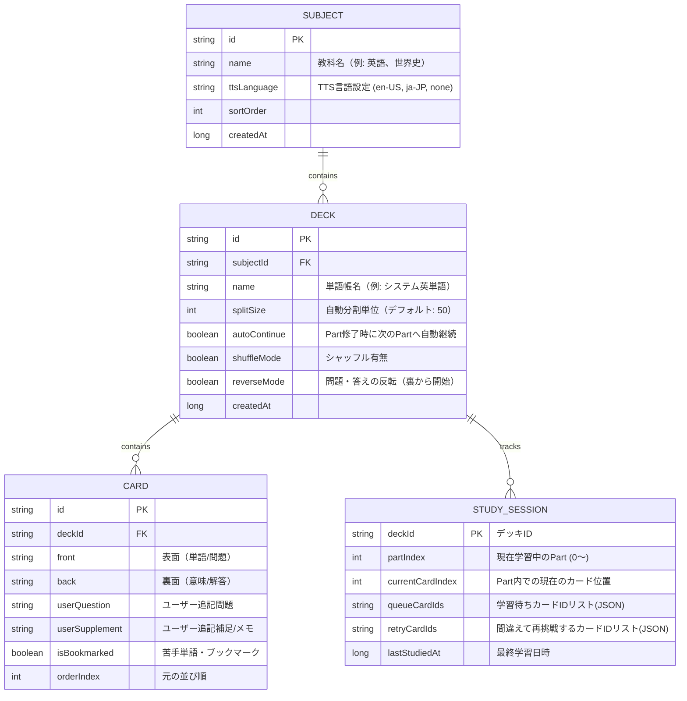
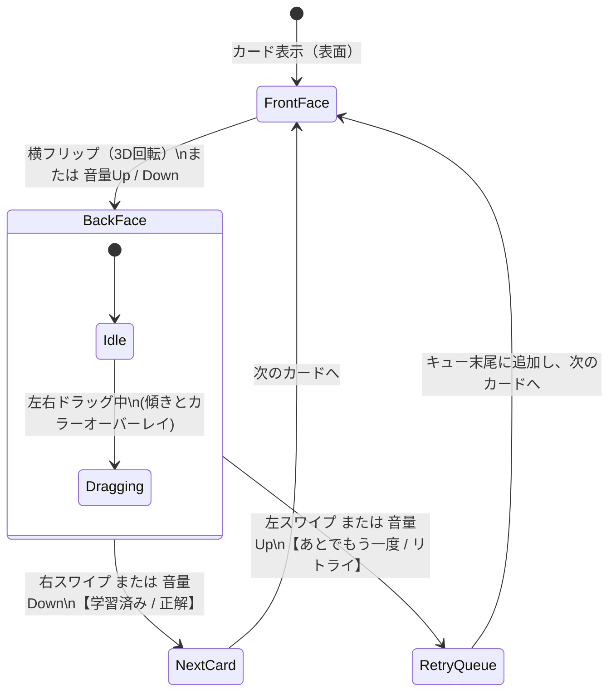

# Aidomari（相泊）アーキテクチャ設計書

## 1. コンセプトと設計哲学

> **設計哲学**:「あらゆる機能は、初めから存在したらどうなっていたかを念頭に開発を進める」  
> 後付けのパッチ当てではなく、複数教科対応、自動分割、関連項目ハイパーリンク、音量キーめくり、セッション永続化を最初から包含した、整合性の高いアーキテクチャ。

### コードネーム「Aidomari（相泊）」の由来
- **知床の最果て（道路の終点）**: 既存の単語帳のレールを越え、自らの手で知のフロンティアを切り拓く。
- **アイヌ語 `ay-tomari`（矢の泊地）**: 音量キーで「矢」のように素早く捌いた知識が、しっかりと頭に「停泊（定着）」する。
- **漢字「相（互いに）」＋「泊（留まる）」**: 単語同士が「相（あい）繋がり合う」**関連項目エンジン**と、いつでも前回の続きから「泊まった場所から再開」できる**セッション永続化**。

---

## 2. ドメイン＆データモデル（Room Database）

---

## 3. UI・ジェスチャー・音量キー仕様

### 状態遷移（State Machine）

- **表面 ➔ 裏面**: 水平ドラッグによる 3D Y軸回転、または音量Up/Down。
- **裏面 ➔ 次のカード**:
  - **右スワイプ** / **音量Down**: 学習済み（正解）➔ 次のカードへ。
  - **左スワイプ** / **音量Up**: あとでもう一度（リトライ）➔ リトライキュー末尾へ追加。

---

## 4. コア機能：関連項目（Keyword）エンジン

1. **インライン・キーワードリンク**:
   - カード裏面の解説テキスト内に、同一教科内の他カードの「見出し語（front）」と一致する単語が存在する場合、自動的にクリッカブルリンク（青下線）化。
2. **関連項目リスト（Related Items）**:
   - カード下部に「▲ 関連項目 (N件)」のアコーディオンを配置し、相互参照している単語を一覧表示。
3. **Keyword Window（ポップアップ・スタック）**:
   - リンクや関連項目タップで **Modal BottomSheet** が開き、現在の学習画面を離れずに単語解説をポップアップ表示。
   - ポップアップ内からさらに別キーワードへジャンプ可能（スタック構造）。
   - 閉じると即座に元の学習画面へシームレスに復帰。

---

## 5. 旧データ互換仕様

旧 Words アプリのエクスポートデータ（3形式）を自動判定してインポート：
1. **現行V2モデル (`Decoders.elm` 形式)**: `modelState`, `books`, `preference` を含む完全ステートJSON。
2. **旧V1モデル (`DecodersV1.elm` 形式)**: `numOfPreference` がない過去のバックアップJSON。
3. **CSV変換JSON (`words-csv-to-json` 形式)**: `[ { "title": "...", "content": [ { "front": "...", "back": "..." } ] } ]` のシンプル配列。
