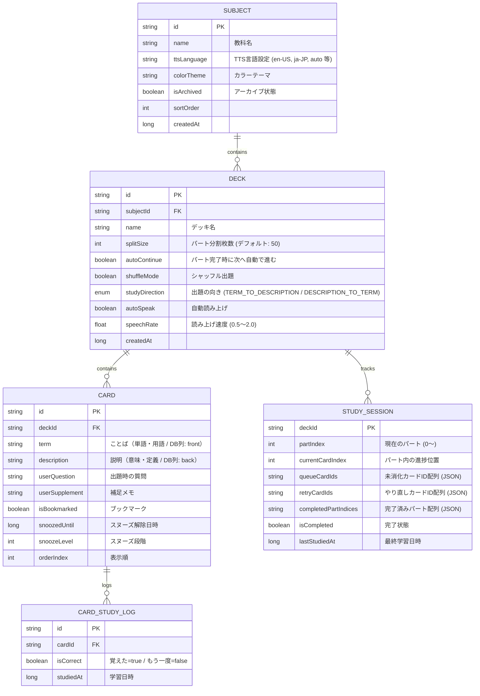
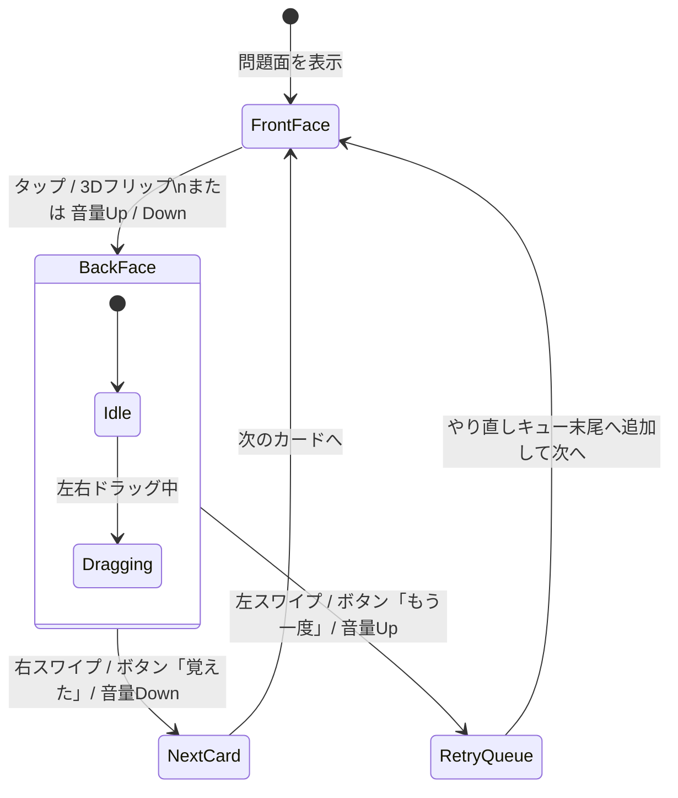

# Aidomari（相泊）アーキテクチャ設計書

## 1. 設計の考え方

複数教科の管理、デッキのパート分割、関連項目リンク、音量キー操作、学習セッションの保存、学習ログ、Web記事からの自動デッキ作成といった要素が互いに噛み合うよう、ドメイン層とプラットフォーム固有層を分けて構成しています。

PC 版対応（Compose Multiplatform Desktop）に向けて、`:shared-core`（ドメイン・純粋ロジック）と `:shared-ui`（共有 Compose UI / ViewModel）を分離し、`:app`（Android）と `:desktopApp`（Windows / デスクトップ JVM）の両方から参照する構成としています。すごろくマップおよびロック画面学習は引き続き `:app` 側で扱います。

### 名称「相泊（Aidomari）」について
- 知床半島の道道終点にある地名「相泊」から採っています。
- 関連項目でカード同士が繋がり、中断した場所から落ち着いて学習を再開できる単語帳にしたい、という意図を込めています。

---

## 2. モジュール構成

```text
aidomari/
├── shared-core/   # 純粋 Kotlin/JVM モジュール
│                  # domain（モデル・リポジトリIF・計算ロジック）、Gemini APIクライアント、
│                  # インポーター/エクスポーター、KeywordEngine、PrivacyFilter、
│                  # LocalIngestServer、ShareArticleFetcher、TtsTextSanitizer
├── shared-ui/     # Compose Multiplatform 共有 UI / ViewModel モジュール (Android + Desktop)
│                  # 教科・デッキ・カード管理、学習画面（キーボード操作含む）、
│                  # 自動デッキ作成画面、カレンダー、テーマ設定、SharedAidomariNavHost
├── app/           # Android アプリモジュール
│                  # Room Database、Android TTS、ロック画面学習、Android共有インテント、
│                  # すごろくマップ描画、Android 用画面ラッパー
├── desktopApp/    # デスクトップ（Windows 想定）JVM アプリモジュール
│                  # SQLite (sqlite-jdbc) リポジトリ、Preferences 設定保存、Desktop TTS、
│                  # LocalIngestServer 起動エントリポイント
└── extensions/
    └── aidomari-browser/  # Chrome / Firefox 向け記事送信 WebExtension
```

---

## 3. ドメイン＆データモデル（Room Database v10）

Room SQLite テーブルは既存データとの互換性を保つため、`cards.front` / `cards.back` や `decks.reverse_mode` などの列名を維持しつつ、ドメインモデル（`:shared-core`）側では意味が明確な `term` / `description` / `studyDirection` にマッピングしています。



これに加え、進捗や取り込み記事を保存する `sugoroku_progress` テーブルと `source_articles` テーブルを持ちます。

---

## 4. 学習画面の操作と状態遷移



- `StudyDirection.TERM_TO_DESCRIPTION`: 問題面に「ことば」、解答面に「説明・補足メモ」を表示します。
- `StudyDirection.DESCRIPTION_TO_TERM`: 問題面に「説明」、解答面に「ことば（＋説明・補足メモ）」を表示します。

---

## 5. 関連項目（Keyword）エンジンと演習中検索

1. **インラインリンク**: 説明文の中に同じ教科内の別カードの「ことば」が含まれている場合、文字数の長い語を優先して検出し、タップ可能なリンクにします。
2. **関連項目一覧**: 語幹や本文の関連性から候補カードを抽出し、カード下部に折りたたみ表示します。
3. **詳細シート (`KeywordBottomSheet`)**: リンクや関連項目をタップすると、学習画面の上からボトムシートを開いて意味やメモを確認できます。シート内の別の語へ続けて移動し、「戻る」で順に戻れます。
4. **演習中検索 (`StudySearchDialog`)**: 演習中のトップバーから同じ教科内のカードを検索でき、詳細シートを開閉しても検索結果の一覧を保ったまま確認を続けられます。

---

## 6. UI コンポーネント構成

画面ごとの状態管理（`ViewModel` と画面ルート Composable）と、描画専用のステートレスなコンポーネントを分けてテストしやすくしています。

- **共通コンポーネント (`com.aidomari.app.ui.components`)**:
  - `StudyDirectionSelector`: 「ことば → 説明」と「説明 → ことば」の切り替えボタン
- **教科一覧・カレンダー・すごろく**:
  - `SubjectListScreen`, `CalendarScreen`, `SugorokuMapScreen`
- **自動デッキ作成 (`com.aidomari.app.ui.digest`)**:
  - `BrowsingDigestScreen`: 取り込み記事一覧、抽出モード選択、候補カードの一覧・編集ダイアログ（`CandidateCardEditDialog`）、出題の向き・保存先指定付きの登録バー
- **デッキ一覧 (`com.aidomari.app.ui.deck.components`)**:
  - `BookmarkDeckCard`, `PastDayDecksCard`, `RandomQuestionsCard`, `DeckItemCard`, `DeckSearchContent`, `DeckDialogs`
- **カード管理 (`com.aidomari.app.ui.card`)**:
  - `CardListScreen`, `CardEditDialog`
- **学習画面 (`com.aidomari.app.ui.study.components`)**:
  - `FlippableCard`, `CardFaceFront`, `CardFaceBack`, `KeywordText`, `KeywordBottomSheet`, `RelatedItemsSection`, `StudySearchDialog`, `StudyTtsSettingsDialog`, `CardEditNotesDialog`, `StudyCompletionDialog`

---

## 7. データ互換仕様

`WordsDataImporter` は入力 JSON を判別し、以下の形式を取り込めます。

1. **Aidomari 形式**: `{ "subjects": [ ... ] }`（`term`/`description`/`studyDirection` に加え、旧バージョン出力の `front`/`back`/`reverseMode` も読み込み可能）
2. **旧 Words（Elm）形式（V1 / V2）**: `modelState`, `menuModel`, `books`, `preference` を含むバックアップ JSON
3. **CSV 変換 JSON**: `[ { "title": "...", "content": [ { "front": "...", "back": "..." } ] } ]` 形式の配列
