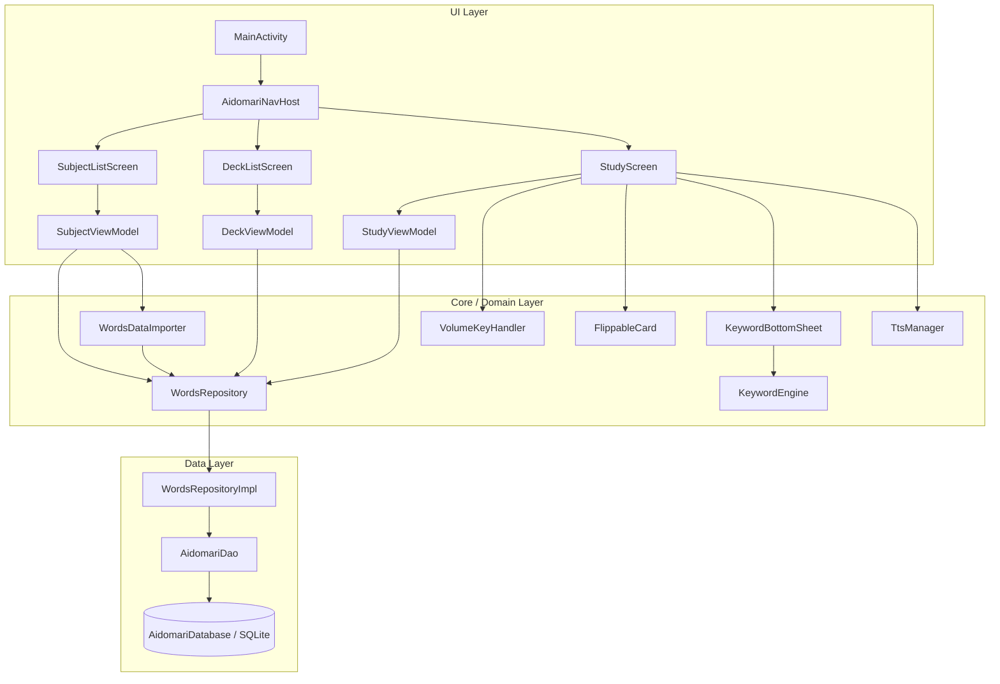
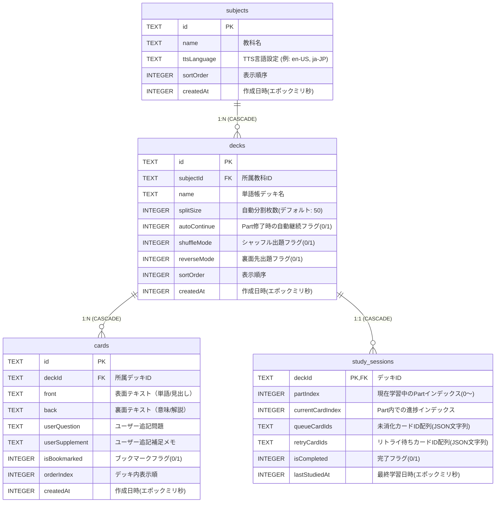
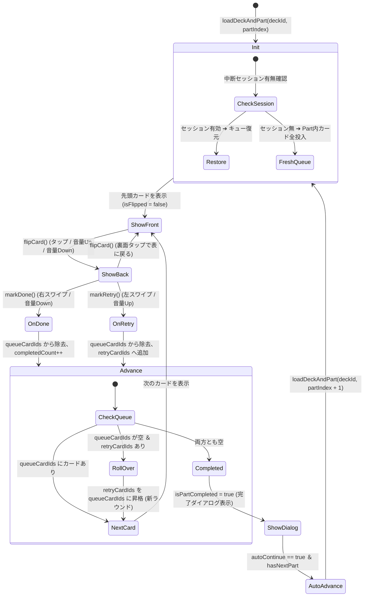
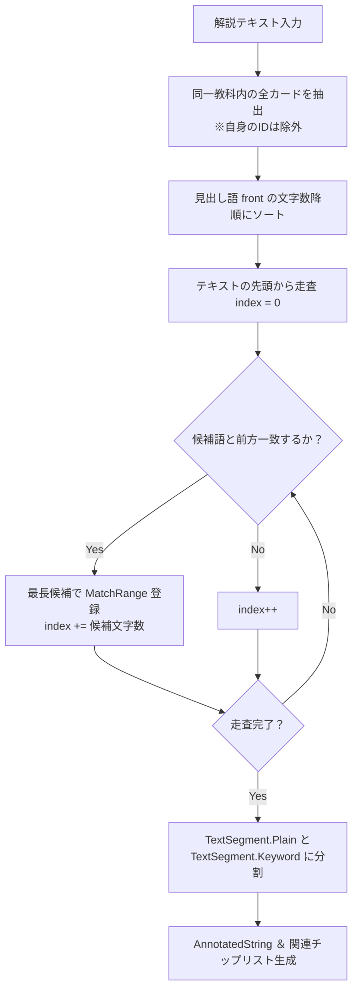
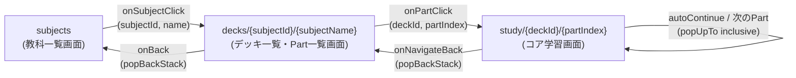

# Aidomari（相泊）詳細設計書

**文書バージョン**: 1.0.0  
**作成日**: 2026-11-01  
**対象リポジトリ**: `https://github.com/txcxjp/aidomari`  
**言語/フレームワーク**: Kotlin 2.0.21 / Jetpack Compose / Room 2.6.1 / Android SDK 35 (minSdk 26)

---

## 目次
1. [システムアーキテクチャ概要](#1-システムアーキテクチャ概要)
2. [データ層・永続化詳細設計](#2-データ層永続化詳細設計)
3. [過去データ互換インポーター設計](#3-過去データ互換インポーター設計)
4. [コア学習エンジン・状態遷移詳細設計](#4-コア学習エンジン状態遷移詳細設計)
5. [ハードウェア音量キー制御設計](#5-ハードウェア音量キー制御設計)
6. [3Dフリップ＆スワイプUI詳細設計](#6-3dフリップスワイプui詳細設計)
7. [関連項目エンジン＆芋づる式探索設計](#7-関連項目エンジン芋づる式探索設計)
8. [バイリンガルText-to-Speech (TTS) 設計](#8-バイリンガルtext-to-speech-tts-設計)
9. [UI画面構成＆画面遷移設計](#9-ui画面構成画面遷移設計)
10. [CI/CDおよびテスト検証設計](#10-cicdおよびテスト検証設計)

---

## 1. システムアーキテクチャ概要

本アプリケーションは、Android 推奨の **Modern Android Architecture (Guide to app architecture)** および **Clean Architecture / MVVM** に厳格に準拠して設計・実装されています。



### パッケージ構成
```
com.aidomari.app/
├── MainActivity.kt                      // エントリポイント、音量キーイベント捕捉
├── AidomariApp.kt                       // Application クラス、DB/リポジトリの DI ホスト
├── core/
│   ├── database/                        // Room DB, Entities, DAO, Repository実装
│   │   ├── AidomariDatabase.kt
│   │   ├── AidomariDao.kt
│   │   ├── SubjectEntity.kt
│   │   ├── DeckEntity.kt
│   │   ├── CardEntity.kt
│   │   ├── StudySessionEntity.kt
│   │   └── WordsRepositoryImpl.kt
│   ├── input/                           // ハードウェア入力管理
│   │   └── VolumeKeyHandler.kt
│   ├── importer/                        // 旧Words/CSV互換JSONインポーター
│   │   └── WordsDataImporter.kt
│   ├── keyword/                         // 関連項目抽出・形態素マッチングエンジン
│   │   └── KeywordEngine.kt
│   └── tts/                             // Android TextToSpeech ラッパー
│       └── TtsManager.kt
├── domain/
│   ├── model/                           // ドメインエンティティ
│   │   ├── Subject.kt
│   │   ├── Deck.kt
│   │   ├── Card.kt
│   │   └── StudySession.kt
│   └── repository/                      // リポジトリインターフェース
│       └── WordsRepository.kt
└── ui/
    ├── navigation/                      // Compose Navigation
    │   └── AidomariNavHost.kt
    ├── subject/                         // 教科管理画面
    │   ├── SubjectListScreen.kt
    │   └── SubjectViewModel.kt
    ├── deck/                            // デッキ・50枚分割Part一覧画面
    │   ├── DeckListScreen.kt
    │   ├── DeckViewModel.kt
    │   └── DeckUiModels.kt
    └── study/                           // コア学習画面
        ├── StudyScreen.kt
        ├── StudyViewModel.kt
        ├── StudyUiState.kt
        └── components/
            ├── FlippableCard.kt         // 3Dフリップ ＆ Tinderスワイプコンポーネント
            ├── CardFaceFront.kt         // 表面UI（問題・単語・音声再生ボタン）
            ├── CardFaceBack.kt          // 裏面UI（解答・補足メモ・判定ボタン）
            ├── KeywordText.kt           // インラインキーワードリンク＆関連チップ
            ├── KeywordBottomSheet.kt    // 芋づる式スタック探索モーダル
            ├── StudyProgressBar.kt     // 進捗バー＆復習待ち件数表示
            ├── StudyTopBar.kt           // 学習専用トップバー
            └── StudyCompletionDialog.kt // Part修了ダイアログ
```

---

## 2. データ層・永続化詳細設計

### 2.1 Room テーブル定義



### 2.2 カスケード削除と整合性保証
- `decks.subjectId` ➔ `subjects.id`（`onDelete = ForeignKey.CASCADE`）
- `cards.deckId` ➔ `decks.id`（`onDelete = ForeignKey.CASCADE`）
- `study_sessions.deckId` ➔ `decks.id`（`onDelete = ForeignKey.CASCADE`）
親エンティティ（教科・デッキ）の削除時に孤立レコードが発生しないよう、SQLite 外部キー制約のカスケードが適用されます。

### 2.3 DAO インターフェース (`AidomariDao`)
- **リアクティブ監視**: `getAllSubjects()`, `getDecksBySubject()`, `getCardsByDeck()` は `Flow<List<T>>` を返却し、データ変更時に UI を自動更新。
- **一括更新**: `insertCards(cards: List<CardEntity>)` による高速一括インポート（トランザクション保護）。
- **ブックマーク更新**: `updateBookmark(cardId, isBookmarked)` により、カード全体を書き換えることなくフラグのみをピンポイント更新。
- **セッション永続化**: `insertSession(session)`（`OnConflictStrategy.REPLACE`）により、学習進行ごとにアトミックに学習状態を保存。

---

## 3. 過去データ互換インポーター設計

`WordsDataImporter` は、旧 Words アプリ（Elm 0.19.1）および各種データ変換ツールの JSON 構造を自動検知して正規化します。

### 3.1 フォーマット判定仕様
1. **配列ルート (`JsonArray`)**:
   - `words-csv-to-json` 形式: `[ { "title": "デッキ名", "content": [ { "front": "...", "back": "..." } ] } ]`
2. **オブジェクトルート (`JsonObject`) かつ `"subjects"` キー保有**:
   - Aidomari 新形式 JSON: `{ "subjects": [ { "name": "...", "decks": [ ... ] } ] }`
3. **オブジェクトルート (`JsonObject`) かつ Elm モデル形式**:
   - `"modelState"`, `"menuModel"`, `"books"`, `"preferenceModel"` を検出。
   - `bookHead` からタイトルと `part` 番号を抽出し、`"ターゲット1900 (Part 1)"` の形式に自動展開。

### 3.2 マッピング仕様表

| 元データフィールド（Elm） | Aidomari フィールド | 備考 |
|---|---|---|
| `bookHead.title` + `part` | `Deck.name` | 例: `"タイトル (Part 1)"` |
| `preference.numOfPreference` | `Deck.splitSize` | 未指定時はデフォルト 50 |
| `preference.autoContinue` | `Deck.autoContinue` | 真偽値 |
| `preference.shuffleMode` | `Deck.shuffleMode` | 真偽値 |
| `content[].word` / `front` | `Card.front` | 表面単語 |
| `content[].meaning` / `back` | `Card.back` | 裏面意味 |
| `content[].user_question` | `Card.userQuestion` | ユーザー追加問題 |
| `content[].user_supplement` | `Card.userSupplement` | ユーザー追加補足 |
| `content[].bookmark_id` | `Card.isBookmarked` | `bookmark_id > 0` ➔ `true` |

### 3.3 ファイル選択インポート ＆ JSONエクスポート設計
- **ファイルピッカー連携 (Storage Access Framework)**:
  - Compose の `rememberLauncherForActivityResult(ActivityResultContracts.OpenDocument())` を使用。
  - MIMEタイプ `application/json`, `text/plain`, `*/*` をサポートし、端末ローカル（ダウンロードフォルダ等）や Google Drive から直接ファイルを選択可能。
  - 選択後、`contentResolver.openInputStream(uri)` からストリームを非同期読込し、`WordsDataImporter` へ直結。
- **データエクスポート (`WordsDataExporter`)**:
  - 全教科、デッキ、単語カード、ブックマーク状態を Aidomari Modern JSON 形式へシリアライズ。
  - `ActivityResultContracts.CreateDocument("application/json")` により、`aidomari_backup.json` として端末ストレージへ直接保存可能。

---

## 4. コア学習エンジン・状態遷移詳細設計

### 4.1 デッキの自動分割（50枚チャンク）アルゴリズム
デッキ内のカード総数 $N$ と分割サイズ $S$（デフォルト: 50）から、`Deck.calculateParts` により動的に `DeckPart` リストを算出：
$$\text{Part Count} = \left\lceil \frac{N}{S} \right\rceil$$
- 各 Part は `startIndex`（含）から `endIndex`（除）のカードスライス範囲を保持。
- `displayRange`: `"1〜50"`, `"51〜100"` 等の表示用文字列を自動生成。

### 4.2 出題キューとリトライループ
`StudyViewModel` は以下の 2 つの動的リストで出題を管理：
1. `queueCardIds: MutableList<String>`（現在ラウンドの出題待ちカード）
2. `retryCardIds: MutableList<String>`（間違えて「もう一度」に送られたカード）



---

## 5. ハードウェア音量キー制御設計

### 5.1 イベント捕捉機構
Android のシステム音量ダイアログの表示とメディア音量変化を抑止し、学習操作に割り当てるため、`MainActivity.dispatchKeyEvent` でイベントをインターセプトします。

```kotlin
// MainActivity.kt
override fun dispatchKeyEvent(event: KeyEvent): Boolean {
    if (event.action == KeyEvent.ACTION_DOWN) {
        if (VolumeKeyHandler.handleKeyEvent(event.keyCode)) {
            return true // イベント消費（システム音量を変更させない）
        }
    }
    return super.dispatchKeyEvent(event)
}
```

### 5.2 ライフサイクル・スコープバインディング
学習画面表示中のみ音量キーを専有し、他の画面（教科一覧・デッキ一覧）では通常の端末音量操作が行えるよう、Compose の `DisposableEffect` を用いてリスナーを登録・破棄します：

```kotlin
// StudyScreen.kt
DisposableEffect(viewModel) {
    VolumeKeyHandler.listener = { isUp ->
        viewModel.onVolumeKey(isUp)
    }
    onDispose {
        VolumeKeyHandler.listener = null
    }
}
```

### 5.3 キーコードマッピング

| カード面 | 音量キー | アクション | 説明 |
|---|---|---|---|
| **表面（Front）** | `KEYCODE_VOLUME_UP` | `flipCard()` | カードを3D回転して裏返す |
| **表面（Front）** | `KEYCODE_VOLUME_DOWN` | `flipCard()` | カードを3D回転して裏返す |
| **裏面（Back）** | `KEYCODE_VOLUME_UP` | `markRetry()` | **もう一度（リトライ）**: 左スワイプ相当 |
| **裏面（Back）** | `KEYCODE_VOLUME_DOWN` | `markDone()` | **覚えた（完了）**: 右スワイプ相当 |

---

## 6. 3Dフリップ＆スワイプUI詳細設計

### 6.1 リアルタイム追従 3D Y軸フリップ (`FlippableCard`)
Jetpack Compose の `Modifier.pointerInput` と `Modifier.graphicsLayer` を活用し、指の動きに1フレーム単位でリアルタイム追従する 3D 物理演算を実装：
- **指の動き幅＆スワイプ方向へのリアルタイム連動（表面）**:
  表面表示時、左右水平ドラッグ量 $\Delta x$ とその方向に応じて回転角 $\theta \in [-180^\circ, +180^\circ]$ をリアルタイム更新：
  $$\text{progress} = \min\left(1.0, \frac{|\Delta x|}{\text{flipDistance}}\right), \quad \text{direction} = \begin{cases} +1 & (\Delta x \ge 0: \text{右スワイプ} \Rightarrow \text{左回転}) \\ -1 & (\Delta x < 0: \text{左スワイプ} \Rightarrow \text{右回転}) \end{cases}$$
  $$\theta = \text{direction} \times \text{progress} \times 180^\circ$$
  指を途中で戻せばカードも戻り、めくり進捗が 38%（約 70°）を超えて離すと $\text{direction} \times 180^\circ$（裏面）へ吸い付くようにスナップ完了。未満なら表面（0°）へバネ復帰（`Spring.DampingRatioMediumBouncy`）。
- **タップ即時フリップ**:
  ドラッグせずタップした場合は、`260ms` の高速トゥイーンアニメーションで即座に裏面（+180°）へフリップ。
- **カード単位のキーイング (`key(card.id)`)**:
  カードごとに Composable ノードを完全分離。次カード遷移時に前カードの裏面回転角が引き継がれて表面へ逆回転する現象を完全に防止し、新カードは常に初期姿勢（表面 0°）で描画。
- **カードスタック構造（次カードの背面プレビュー）**:
  前面カードの背面に `nextCard` を `scale = 0.94f`, `alpha = 0.85f`, `elevation = 2.dp` で待機描画。前面カード退場時、次カードが `scale = 0.94f ➔ 1.0f`（160ms）へスムーズにスケールアップして昇格。
- **カメラ距離**: `cameraDistance = 16f * density`（パースペクティブ歪みを防止し、自然な立体感を演出）。
- **裏面テキスト反転防止**:
  回転角 $|\theta| > 90^\circ$ の瞬間、裏面 Composable に切り替わり、裏面コンテナ内部で `rotationY = 180f` を適用して文字の鏡像反転を相殺。

### 6.2 リアルタイム Tinder 風ドラッグジェスチャーと判定物理
裏面表示時、`awaitEachGesture` による低遅延入力パイプラインで指に吸い付くドラッグを実現：
- **1:1 リアルタイム追従**: 指の水平ドラッグ量 $\Delta x$ に完全同期してカード座標を更新。
- **カードの傾き**: $Z\text{軸回転角} = \left(\frac{\Delta x}{25}\right) \in [-15^\circ, +15^\circ]$
- **判定閾値**: $\text{DRAG\_THRESHOLD} = 220\text{px}$
- **アクション境界**:
  - $\Delta x > +220\text{px}$: 画面右外へ高速アニメーション（画面幅連動 `offscreenTarget`）➔ `onDone()`
  - $\Delta x < -220\text{px}$: 画面左外へ高速アニメーション（画面幅連動 `-offscreenTarget`）➔ `onRetry()`
  - 不足時: バネのように中央へ復帰（`spring(dampingRatio = MediumBouncy)`）
- **裏面タップのめくり戻し**:
  裏面背景をタップすると、カードが表面（0°）へ即座に回転して戻る。
- **縦スクロールとの自然な調停**:
  解説テキストの縦方向ドラッグ量（$\Delta y$）が先行した場合は水平スワイプ判定を譲渡し、解説文の縦スクロール（`verticalScroll`）を一切阻害しない。
- **退場時ジェスチャー無効化 (`isDismissing`)**:
  閾値を超えて画面外への退場アニメーション開始後はジェスチャーを遮断し、退場中の再ドラッグや操作の競合を防止。
- **ビジュアルフィードバック**:
  ドラッグ距離に比例したアルファ値（透明度）で、右ドラッグ時は「覚えた（緑）」、左ドラッグ時は「もう一度（赤）」のバッジがリアルタイムに浮き上がるインタラクションを実装。

---

## 7. 関連項目エンジン＆芋づる式探索設計

### 7.1 最長一致（Greedy）抽出アルゴリズム
単語の解説文に含まれる他単語を自動リンク化する際、部分一致の誤爆（例: 「ローマ帝国」の中に含まれる「ローマ」で先に切れてしまう現象）を防ぐため、**候補単語の文字数降順（Longest Match First）** でマッチングを実行します。



### 7.2 芋づる式スタック探索 (`KeywordBottomSheet`)
学習の文脈を失わずに知識を深掘りできるよう、モーダルシート内に独立したナビゲーションスタックを実装：
- `cardStack = remember { mutableStateListOf<Card>() }`
- **階層遷移**: BottomSheet 内の解説文にあるキーワードをタップすると、現在のカードの上に新しいカードを `push`（`cardStack.add(nextCard)`）。
- **戻る操作**: ヘッダーの「← 戻る (N)」ボタンで直前のカードへ `pop`（`cardStack.removeLast()`）。
- **セッション非破壊**: 探索を何十回繰り返しても、シートを閉じれば背面の学習セッションは 1 ミリも狂わずにそのまま継続。

---

## 8. バイリンガルText-to-Speech (TTS) 設計

### 8.1 `TtsManager` 仕様
Android 標準の `android.speech.tts.TextToSpeech` をカプセル化：
- **初期化**: `OnInitListener` により非同期初期化を安全に完了後、利用可能フラグを更新。
- **言語自動解決 (`resolveLocale`)**:
  - `"en-US"`, `"en"` ➔ `Locale.US`
  - `"ja-JP"`, `"ja"` ➔ `Locale.JAPAN`
  - `"zh-CN"` ➔ `Locale.SIMPLIFIED_CHINESE`
  - `"ko-KR"` ➔ `Locale.KOREA`
  - `"auto"`, `""` ➔ 端末デフォルトの `Locale.getDefault()`
- **発声制御**: `TextToSpeech.QUEUE_FLUSH` により、連続タップ時も前の音声をキャンセルして最新の単語を即座に発音。
- **リソース解放**: `Activity.onDestroy()` に連動して `shutdown()` を呼び出し、メモリリークを防止。

---

## 9. UI画面構成＆画面遷移設計

### 9.1 ルーティング定義 (`AidomariNavHost`)



### 9.2 画面ごとの責任分担
1. **`SubjectListScreen`**:
   - 教科カード（教科名、設定TTS言語バッジ、削除アクション）。
   - 新規教科作成ダイアログ（名称入力、TTS言語選択ラジオ）。
   - 過去データインポートダイアログ（JSONテキスト貼り付け ➔ `WordsDataImporter` 実行 ➔ 結果スナックバー表示）。
2. **`DeckListScreen`**:
   - デッキサマリー（総単語数、シャッフル、自動継続バッジ）。
   - 50枚分割 Part リスト表示（未着手 / 進行中 `再開 (32/50)` / 完了 `✓` バッジ）。
   - 新規デッキ作成ダイアログ（分割枚数、自動継続、シャッフルのトグル設定）。
3. **`StudyScreen`**:
   - 進捗ヘッダー（`completedCount / totalInPart`、復習待ち件数 `retryCount`、ブックマークトグル）。
   - メインカードエリア（`FlippableCard`、タップ/スワイプ/音量キーによる進行）。
   - 関連項目モーダル（`KeywordBottomSheet`）。
   - 修了ダイアログ（`StudyCompletionDialog`、次Partへの自動/手動進行）。

---

## 10. CI/CDおよびテスト検証設計

### 10.1 GitHub Actions パイプライン仕様 (`.github/workflows/ci.yml`)
すべての `main` ブランチへのプッシュ、および `feat/**`, `fix/**` ブランチへのプッシュに対して自動実行されます。

1. **Job 1: Code Quality (Spotless & Lint)**
   - `spotlessKotlinCheck`: ktlint 1.3.1 によるインポート順序、構文規則、命名規則の静的検証。
   - `lintDebug`: Android 公式 Lint 解析とレポート生成。
2. **Job 2: Unit Tests**
   - `./gradlew testDebugUnitTest --continue`
   - JUnit4, Robolectric (SQLite / Room In-Memory 検証), Kotlin Coroutines Test による非同期フロー検証。
3. **Job 3: Build Debug APK**
   - `./gradlew assembleDebug`
   - **CI自動バージョン発番**: `GITHUB_RUN_NUMBER` 環境変数を `versionCode`（単調増加整数）および `versionName`（`1.0.0.<run_number>`）に動的バインド。ローカル時は `1.0.0-dev`。
   - **固定デバッグ署名 (`app/debug.keystore`)**: CI ランナー間で共通の署名キーストアを使用し、ビルドごとに署名鍵が変わって端末で上書きインストール（インプレースアップデート）に失敗する現象を防止。
   - ビルド完了後、署名済みデバッグ APK（`aidomari-debug-apk`）を GitHub Artifacts へ自動アップロード。教科一覧画面のヘッダーに現在のバージョン番号を表示。

### 10.2 ユニットテスト一覧

| テストクラス | 対象モジュール | 検証内容 |
|---|---|---|
| `AidomariDaoTest` | `core.database` | SQLite CRUD、カスケード削除、ブックマーク更新、セッション保存 |
| `DeckTest` | `domain.model` | カード総数に応じた 50 枚分割（Part 1〜N）の境界値計算 |
| `WordsDataImporterTest` | `core.importer` | CSV形式、Elm V1/V2 形式、新形式 JSON のパースおよび DB 登録整合性 |
| `WordsDataExporterTest` | `core.importer` | 全データの JSON エクスポート生成およびラウンドトリップ再インポート検証 |
| `StudyViewModelTest` | `ui.study` | フリップ、正解/リトライキュー遷移、音量キー操作、自動継続フラグ、セッション永続化 |
| `KeywordEngineTest` | `core.keyword` | 最長一致マッチング、大文字小文字無視、自身ID除外、出現順抽出 |
| `TtsManagerTest` | `core.tts` | 言語タグ（en-US, ja-JP 等）から Android Locale への解決 |
| `SubjectViewModelTest` | `ui.subject` | 教科の作成・削除・インポートハンドリング |
| `DeckViewModelTest` | `ui.deck` | デッキ作成、カード枚数・Part分割・セッション進捗の合成モデル生成 |
