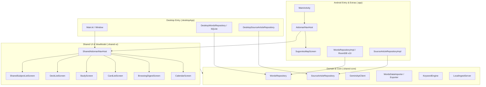
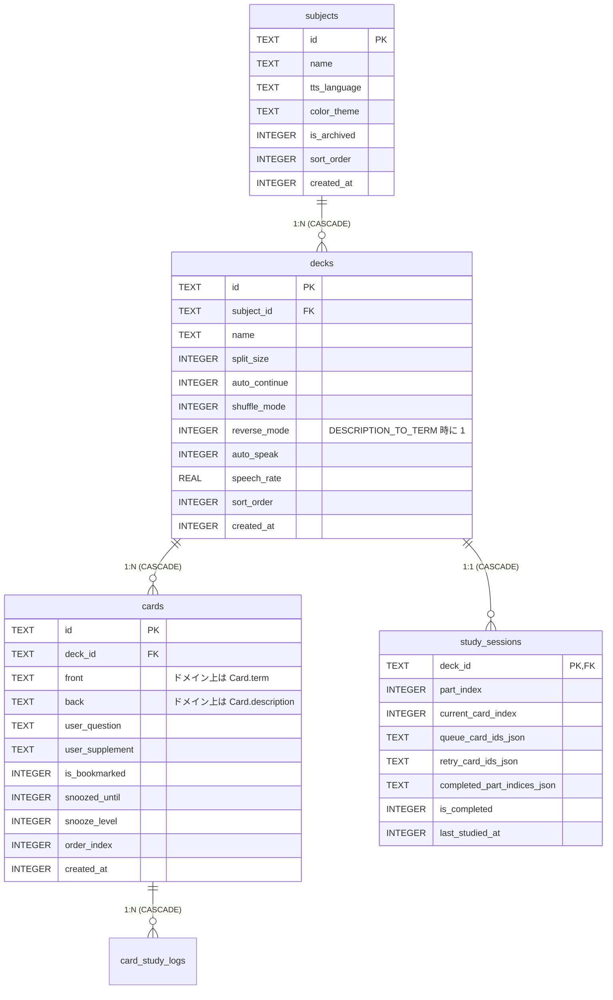

# Aidomari（相泊）詳細設計書

**対象リポジトリ**: `https://github.com/txcxjp/aidomari`  
**主な技術**: Kotlin 2.0.21 / Jetpack Compose (Material 3) / Room 2.6.1 (DB version 10) / Android SDK 35 (minSdk 26)

---

## 目次
1. [全体構成とパッケージ一覧](#1-全体構成とパッケージ一覧)
2. [データ層・永続化設計](#2-データ層永続化設計)
3. [データ互換インポーター / エクスポート設計](#3-データ互換インポーター--エクスポート設計)
4. [学習進行・出題制御](#4-学習進行出題制御)
5. [音量キー・フリップ・スワイプ操作](#5-音量キーフリップスワイプ操作)
6. [関連項目エンジンと演習中検索](#6-関連項目エンジンと演習中検索)
7. [自動デッキ作成（Gemini API / ローカル受信サーバー / 共有インテント）](#7-自動デッキ作成gemini-api--ローカル受信サーバー--共有インテント)
8. [音声読み上げ（TTS）と画面構成](#8-音声読み上げttsと画面構成)

---

## 1. 全体構成とパッケージ一覧

システム全体は `:shared-core`（純粋 Kotlin/JVM 層）、`:shared-ui`（Android / Desktop 共通の Compose UI・ViewModel 層）、`:app`（Android 固有機能・Room DB 層）、`:desktopApp`（Desktop JVM 固有機能・SQLite DB 層）に分かれています。

### 主なパッケージ構成
- **`:shared-core` (`shared-core/src/main/kotlin/com/aidomari/app/`)**:
  - `domain/model/`: `Subject`, `Deck`, `StudyDirection`, `Card`, `StudySession`, `CardStudyLog`, `DailyStudyStats`, `PastDayDeck`, `SugorokuNode`, `SugorokuProgress`, `ai/*`, `article/*`
  - `domain/repository/`: `WordsRepository`, `SourceArticleRepository`
  - `domain/util/`: `CardSnoozeCalculator`, `PastDayDecksCalculator`, `StudyStatsCalculator`, `SugorokuWalkingCalculator`
  - `core/ai/`: `GeminiApiClient`, `GeminiConfig`, `GeminiConfigStore`, `HttpTransport`, `DefaultHttpsUrlConnectionTransport`, `CardGenerationNotificationController`
  - `core/debug/`: `SugorokuSpeedProvider`
  - `core/importer/`: `WordsDataImporter`, `WordsDataExporter`
  - `core/keyword/`: `KeywordEngine`
  - `core/privacy/`: `PrivacyFilter`
  - `core/server/`: `LocalIngestServer`, `LocalIngestServerManager`
  - `core/share/`: `ShareArticleFetcher`, `ShareIntentParser`
  - `core/tts/`: `TtsSpeaker`, `TtsTextSanitizer`
- **`:shared-ui` (`shared-ui/src/{commonMain,androidMain,desktopMain}/kotlin/com/aidomari/app/`)**:
  - `ui/`: 共有 ViewModel・Compose 画面（`subject`, `deck`, `card`, `study`, `digest`, `calendar`, `settings`, `theme`, `navigation`, `components`, `preview`）
  - `ui/platform/`: `PlatformBackHandler`, `PlatformSystemBarsEffect`, `PlatformVolumeKeyEffect`, `rememberPlatformJsonFileHandler` 等の `expect` / `actual` 抽象
- **`:app` (`app/src/main/java/com/aidomari/app/`)**:
  - `core/database/`: `AidomariDatabase`, `AidomariDao`, `SourceArticleDao`, `entity/*`, `WordsRepositoryImpl`, `SourceArticleRepositoryImpl`, `SampleData`
  - `core/lockscreen/`, `core/tts/TtsManager`, `core/ai/CardGenerationService`, `core/ai/GeminiPreferences`, `core/debug/SugorokuDebugPreferences`
  - `domain/model/`: Android リソース・アセットに紐づくすごろく用モデル（`Act1TravelRoute`, `HokkaidoRoadNetwork`, `RoadsideLandmark`, `TravelerCompanion` 等）
  - `ui/sugoroku/`, `ui/lockscreen/`, `ui/share/`, `AidomariNavHost`, `SubjectListScreen`（Android 用ラッパー）
- **`:desktopApp` (`desktopApp/src/main/kotlin/com/aidomari/app/desktop/`)**:
  - `Main.kt`: Compose Desktop ウィンドウ・`LocalIngestServerManager` 起動
  - `DesktopDatabase`, `DesktopWordsRepository`, `DesktopSourceArticleRepository`: `sqlite-jdbc` 永続化
  - `DesktopConfigStores`, `DesktopTtsSpeaker`, `DesktopAppDirs`: 設定保存・OS別データパス（Windows `%APPDATA%\Aidomari` 等）・読み上げ

---

## 2. データ層・永続化設計

### 2.1 Room テーブル定義（Version 10）

その他、`card_study_logs`（日次の回答履歴・カレンダー・過去のカード計算用）、`sugoroku_progress`（歩行距離と現在地記録）、`source_articles`（取り込み済み Web 記事とステータス）を管理します。

- 既存ユーザー DB との互換性を保つため、SQLite 列名（`cards.front`, `cards.back`, `decks.reverse_mode` 等）は変更せず、`WordsRepositoryImpl` のマッパーでドメイン側の `term` / `description` / `studyDirection` と相互変換しています。

---

## 3. データ互換インポーター / エクスポート設計

`WordsDataImporter` は JSON のトップ構造からフォーマットを自動判別します。

1. **配列ルート (`JsonArray`)**: `words-csv-to-json` 形式（`title` と `content` 配列）
2. **オブジェクトルート + `"subjects"` キー**: Aidomari 形式（`term` / `description` / `studyDirection` と、旧エクスポート形式の `front` / `back` / `reverseMode` をどちらも解釈）
3. **オブジェクトルート + Elm モデル形式**: `modelState` / `menuModel` / `books` を含むデータ。複数パートに分かれた同一タイトルのブックは 1 つのデッキへ統合し、`orderIndex` を連番で振り直します。

ファイル選択・保存は Android の Storage Access Framework（`OpenDocument` / `CreateDocument`）を使用し、JSON バックアップファイルの読み込みと書き出し（`WordsDataExporter`）を行えます。

---

## 4. 学習進行・出題制御

### 4.1 パート分割
`Deck.calculateParts(totalCards)` により、総枚数と `splitSize`（デフォルト 50）から `DeckPart` の範囲（`startIndex` 〜 `endIndex`）を算出します。スヌーズ中のカードがあってもパート境界が次パートへずれないよう、全カード基準でスライスした上でパート内の有効カードを抽出します。

### 4.2 出題キューとやり直しループ
`StudyViewModel` は `queueCardIds`（今回の出題待ち）と `retryCardIds`（「もう一度」に送ったカード）の 2 つのキューを持ちます。
- 「覚えた (`markDone`)」: 先頭カードをキューから除き、`CardStudyLog` を記録して次へ進みます。
- 「もう一度 (`markRetry`)」: 先頭カードを `retryCardIds` の末尾へ移し、次へ進みます。
- `queueCardIds` が空になった時点で `retryCardIds` が残っていれば、それを新しい `queueCardIds` として出題を続けます。両方が空になるとパート完了となります。

### 4.3 スヌーズ・過去デッキ・ランダム出題
- **スヌーズ（休眠）**: `CardSnoozeCalculator` に従い、段階に応じて一定期間出題対象から外します。
- **仮想デッキ**: ブックマーク集約 (`bookmark_*`)、ランダム出題 (`random_*`, `random_deck_*`)、過去日の復習 (`past_yesterday_*`, `past_week_*`, `past_month_*`) を通常の学習画面から同じ操作感で扱えます。

---

## 5. 音量キー・フリップ・スワイプ操作

- **音量キー (`VolumeKeyHandler`)**: `MainActivity.dispatchKeyEvent` で捕捉し、学習画面表示中だけリスナーへ渡します。
  - 問題面: 音量上下どちらでも裏返し
  - 解答面: 音量下で「覚えた」、音量上で「もう一度」
- **フリップ＆スワイプ (`FlippableCard`)**:
  - タップまたは横ドラッグに追従してカードを Y 軸回転させ、裏面に切り替わると左右スワイプで判定できます。
  - 解説テキストが長い場合は縦スクロール（`verticalScroll`）を優先し、横スワイプ判定と競合しないようにしています。
  - `CardFaceFront` / `CardFaceBack` では表示文字数に応じてフォントサイズと行間を段階的に調整します。

---

## 6. 関連項目エンジンと演習中検索

- **`KeywordEngine`**: 説明テキスト内にある同一教科の他カードの `term` を最長一致（文字数の長い候補を優先）で検出し、タップ可能なリンクにします。また語幹や表記をもとにした関連カード一覧も組み立てます。
- **`KeywordBottomSheet`**: リンクから詳細シートを階層的に開け、「戻る」で前のカードへ戻れます。シート内からのメモ編集・削除にも対応します。
- **`StudySearchDialog`**: 演習を中断せず教科内のカードを検索し、詳細シートを確認したあと元の検索結果一覧へ戻れます。

---

## 7. 自動デッキ作成（Gemini API / ローカル受信サーバー / 共有インテント）

1. **記事取り込み経路**:
   - **ローカル HTTP 受信サーバー (`LocalIngestServer`)**: `127.0.0.1:8877` で待機し、ブラウザ拡張（[extensions/aidomari-browser](extensions/aidomari-browser/README.md)）からの記事ペイロードを受信します。プライバシー保護のため、`PrivacyFilter` によりローカルアドレスや管理画面系ドメインを除外します。
   - **Android 共有インテント (`ShareReceiverActivity`)**: 他アプリやブラウザの「共有」から送られた URL / テキストを `ShareIntentParser` と `ShareArticleFetcher` で処理し、`source_articles` に保存します。
2. **Gemini API 連携 (`GeminiApiClient`)**:
   - 抽出モードは **おまかせ（SMART）**・**要旨重視（CORE）**・**用語網羅（KNOWLEDGE）** の3種類。
   - SMART モードではまず記事の性質を判定し、解説・事典系の記事はテーマ分割による多段階抽出と重複統合を行い、コラム等は要旨抽出へ振り分けます。
   - `responseSchema` に `term` / `description` / `userSupplement` を指定し、記事本文に書かれた事実に沿うようプロンプトで制約しています。
3. **作成結果のレビュー (`CardReviewDialog`)**:
   - バックグラウンド生成の進捗率を表示し、完了後に `CandidateCardEditDialog` で個々のカードを大きく編集できます。
   - 登録時の出題の向き（`StudyDirectionSelector`）はデフォルトで「説明 → ことば」とし、必要に応じて「ことば → 説明」へ切り替えて保存できます。

---

## 8. 音声読み上げ（TTS）と画面構成

- **`TtsManager` / `TtsTextSanitizer`**: Android の `TextToSpeech` をラップし、ルビ記法 `[漢字|かな]` や装飾記号を取り除いた自然なテキストを読み上げます。教科ごとの言語設定（`en-US`, `ja-JP`, `zh-CN`, `ko-KR`, `auto`）とデッキごとの再生速度・自動読み上げ設定に従います。
- **主な画面ルート (`AidomariNavHost`)**:
  - `subjects` (`SubjectListScreen`): 教科一覧、新規作成、インポート/エクスポート、テーマ設定、ロック画面設定、アーカイブ表示
  - `decks/{subjectId}/{subjectName}` (`DeckListScreen`): デッキ一覧、検索、ブックマーク・過去復習・ランダム出題、向きバッジ切替
  - `cards/{deckId}` (`CardListScreen`): カード一覧・追加・編集・メモ閲覧
  - `study/{deckId}/{partIndex}` (`StudyScreen`): カード演習画面
  - `digest` (`BrowsingDigestScreen`): 自動デッキ作成（未処理記事管理・カード候補編集・登録）
  - `calendar` (`CalendarScreen`): 日別学習履歴カレンダー
  - `sugoroku` (`SugorokuMapScreen`): 北海道ルート・ランドマークのすごろくマップ
