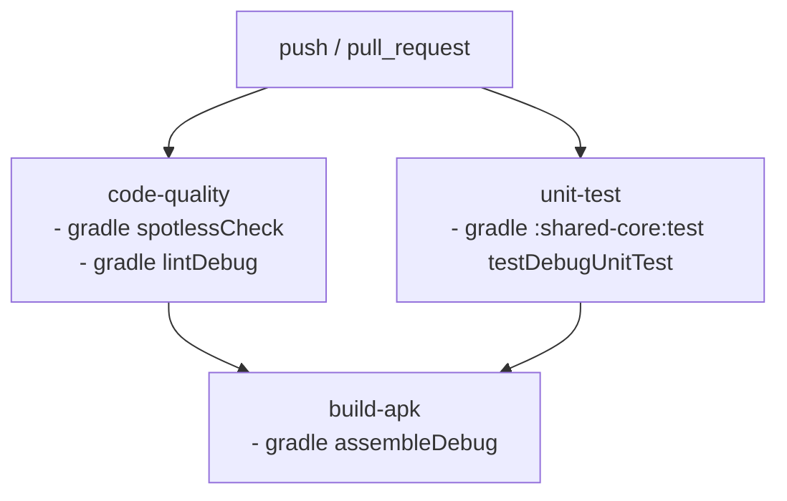

# Aidomari 開発・CI/CD ガイド

本リポジトリの開発環境、よく使うコマンド、ブランチ運用、テスト方針をまとめています。

---

## 1. 開発環境

- **JDK**: Java 17（Temurin 推奨）
- **Android SDK**: compileSdk 35, minSdk 26
- **Gradle**: 8.10.2（Gradle Wrapper 同梱）
- **モジュール**:
  - `:shared-core`（純粋 Kotlin / JVM ライブラリ）
  - `:app`（Android アプリ）

---

## 2. 開発時によく使うコマンド

### コードフォーマット（Spotless / ktlint）
コミット前の整形と検証：
```bash
./gradlew spotlessApply
./gradlew spotlessCheck
```

### 単体テストの実行
共通モジュールと Android アプリの両方を実行する場合：
```bash
./gradlew :shared-core:test testDebugUnitTest
```
- `:shared-core` の結果: `shared-core/build/reports/tests/test/index.html`
- `:app` の結果: `app/build/reports/tests/testDebugUnitTest/index.html`

### Android Lint の実行
```bash
./gradlew lintDebug
```
解析結果は `app/build/reports/lint-results-debug.html` に出力されます。

### デバッグ APK のビルド
```bash
./gradlew assembleDebug
```
出力先: `app/build/outputs/apk/debug/app-debug.apk`

---

## 3. GitHub Actions CI

`.github/workflows/ci.yml` により、`main` / `v1.x` / `feat/**` / `fix/**` へのプッシュおよび `main` / `v1.x` 向け Pull Request で実行されます。



主なアップロード成果物（Artifacts）：
- `aidomari-debug-apk`: `app/build/outputs/apk/debug/app-debug.apk`
- `lint-report`: `app/build/reports/lint-results-debug.html`
- `test-results`: `app/build/reports/tests/testDebugUnitTest/`

---

## 4. 依存関係の管理

ライブラリとプラグインのバージョンは [`gradle/libs.versions.toml`](../gradle/libs.versions.toml) にまとめています。追加・更新時は原則として Version Catalog 経由で管理します。

---

## 5. ブランチ運用ルール

1. **`main` ブランチ**: 常にビルドとテストが通る状態を保ちます。
2. **作業ブランチ**: 機能開発や不具合修正ごとに `feat/*` や `fix/*` を切って進めます（例: `feat/issue-95-...`）。後回しにする機能はマージせずブランチのまま保留できます。
3. **Issue との紐づけ**: コミットメッセージに `refs #番号`、マージ時や PR 本文に `Closes #番号` を記載して履歴と Issue を辿れるようにしています。

---

## 6. テスト方針

- **`:shared-core` の純粋 JVM テスト**: ドメインモデル、計算ロジック、Gemini API パーサ・プロンプト構築、`WordsDataImporter` / `Exporter`、`KeywordEngine`、`ShareArticleFetcher`、`PrivacyFilter` などは Android SDK や Robolectric に依存せず高速に検証します。
- **`:app` の単体テスト・UI テスト**: Room DAO（In-Memory SQLite）、ViewModel、Compose 画面・ダイアログ、統合シナリオテスト（`app/src/test/java/com/aidomari/app/scenario/`）を実行します。
- **統合シナリオテストの扱い**: 新機能の追加や画面フロー・DB スキーマに関わる変更時は、`FakeRepository` だけの検証にとどまらず、実 SQLite（In-Memory Room）を含めた整合性確認を追加・更新します。

---

## 7. Compose Preview と初期データ

- 状態管理を持つ `Screen` コンポーザブルと、引数だけで描画する `Content` コンポーザブルを分けることで、`@ThemePreviews`（ライト / ダーク比較）によるプレビュー確認や UI テストを行いやすくしています。
- プレビュー用データは `com.aidomari.app.ui.preview.PreviewSampleData` に集約しています。
- 初回起動時の初期サンプルデータ投入は `SampleData` により行われます。
