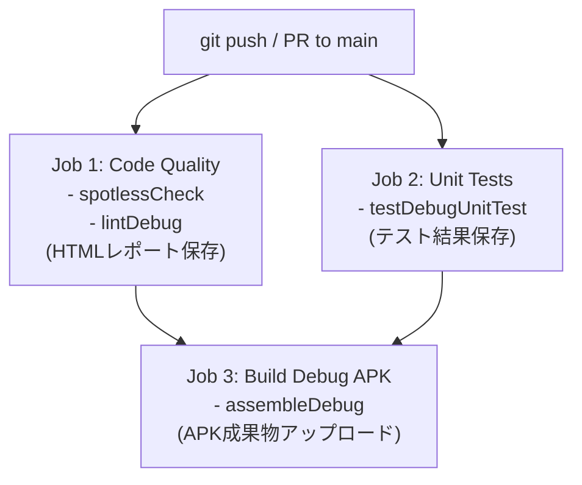
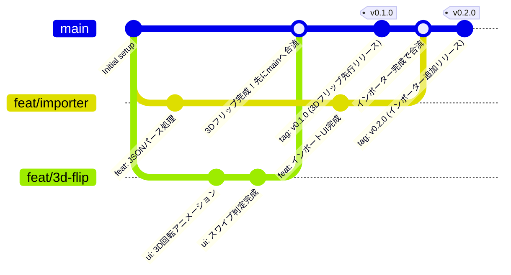

# Aidomari 開発・CI/CD ガイド

本プロジェクトの開発サイクル、コード規約、テスト、CI/CD パイプラインについての解説です。

---

## 1. 開発環境要件

- **JDK**: Java 17 (Temurin 推奨)
- **Android SDK**: compileSdk 35, minSdk 26
- **IDE**: Android Studio Ladybug (2024.2.1) 以降推奨
- **Gradle**: 8.10.2 (Gradle Wrapper 同梱)

---

## 2. 日常の開発サイクル（コマンド集）

### コードの自動整形（Spotless / ktlint）
コミット前にコードスタイルを自動適用します：
```bash
./gradlew spotlessApply
```
コードスタイルの検証のみを行う場合：
```bash
./gradlew spotlessCheck
```

### 単体テストの実行
すべての Unit Test を実行します：
```bash
./gradlew testDebugUnitTest
```
テスト結果レポートは `app/build/reports/tests/testDebugUnitTest/index.html` に出力されます。

### Android Lint の実行
静的解析を実行します：
```bash
./gradlew lintDebug
```
解析結果は `app/build/reports/lint-results-debug.html` に出力されます。

### デバッグ用 APK のビルド
ローカルで APK を生成します：
```bash
./gradlew assembleDebug
```
生成物: `app/build/outputs/apk/debug/app-debug.apk`

---

## 3. GitHub Actions CI/CD パイプライン

`.github/workflows/ci.yml` により、`main` ブランチへのプッシュおよび Pull Request 作成時に自動実行されます。



### 自動アップロードされる成果物（Artifacts）
- **`aidomari-debug-apk`**: CIでビルドされたインストール可能な実機用 APK。GitHub のアクション実行画面からワンクリックでダウンロード可能です。
- **`lint-report`**: Android Lint の詳細 HTML レポート。
- **`test-results`**: 単体テストの詳細レポート。

---

## 4. 依存関係の管理（Version Catalog）

すべてのライブラリおよびプラグインのバージョンは、**`gradle/libs.versions.toml`** に集約されています。

```toml
[versions]
agp = "8.7.2"
kotlin = "2.0.21"
room = "2.6.1"
composeBom = "2024.10.01"
```

ライブラリの追加・更新は必ずこのファイルを経由して行います。

---

## 5. リポジトリ運用方針（Short-lived Feature Branch 戦略）

GitFlow のような `develop` や `release` などの肥大化しやすい中間層を全廃し、**「複数機能の並行開発」** と **「リリースの取捨選択（この機能は後回しなど）」** を最小の負荷で両立するブランチ戦略を採用します。



### 運用ルール

1. **`main` ブランチ**:
   - 常に「ビルド可能で、テストがパスする」安定版。
   - 完成した機能のみをマージします。
2. **フィーチャーブランチ（`feat/*`, `fix/*`, `ui/*`）**:
   - 機能ごとに `main` からブランチを作成（例: `feat/room-db`, `feat/volume-key`, `feat/importer`）。
   - **並行開発**: ブランチを切り替えることで、複数の機能を互いに干渉せず並行して開発可能。
   - **リリースの取捨選択**: 「この機能は後回しにしよう」と判断した場合、マージせずブランチのまま寝かせておく。`main` は一切汚れません。
3. **PR（プルリクエスト）は「実機テスト用 APK を焼くスイッチ」**:
   - ブランチを push して GitHub で PR を開くと、GitHub Actions が自動で検証＆実機用 APK を生成。
   - スマホで APK をテストして問題なければ、GitHub 上で **[Squash and merge]** ボタンを押してマージ（ブランチは削除）。
4. **リリースとタグ打法**:
   - 節目となるバージョン（例: `v0.1.0`, `v0.2.0`）に達した際、`main` 上でタグを打って push：
     ```bash
     git tag v0.1.0
     git push --tags
     ```

